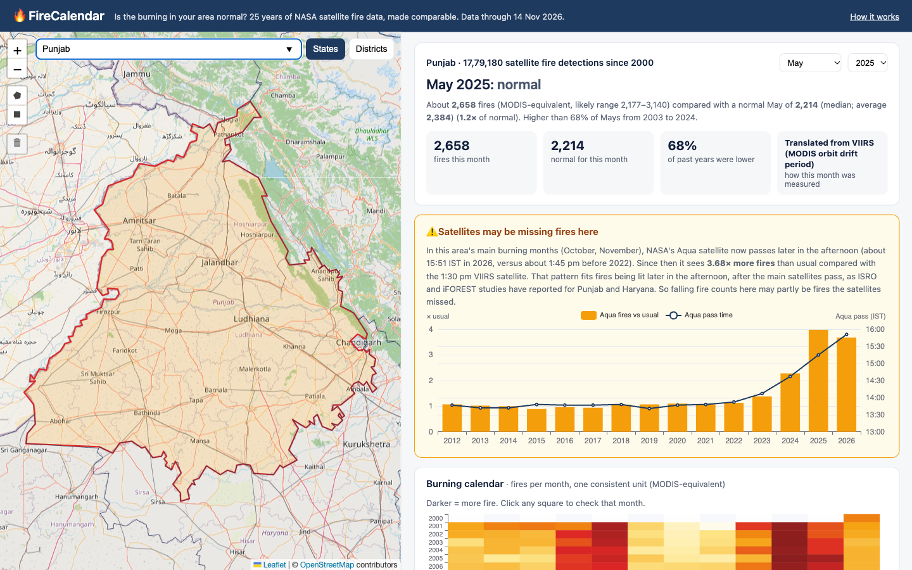

# FireCalendar — is the burning in your area normal?

**Live app:** https://firecalendar-ten.vercel.app (no login)

**Demo video (30 s):** [docs/FireCalendar_demo_30s.mp4](docs/FireCalendar_demo_30s.mp4) · **Slides:** [docs/FireCalendar_slides.pdf](docs/FireCalendar_slides.pdf)
NASA Space Apps Challenge 2026 · *Harmonization of MODIS and VIIRS Hot Spots*

FireCalendar turns 25 years of NASA satellite fire detections (MODIS 2000→, VIIRS 2012→) into **one consistent
series** and a **burning-activity calendar** for any Indian state, district, drawn polygon or lat/lon point. For any
month it answers: *how much fire, compared with normal, and how sure are we?*



## What it does
- **One unit across sensors:** MODIS-equivalent fire counts, Dec 2000 → 14 Nov 2026.
- **Burning calendar** (years × months), monthly time series with an uncertainty band, yearly totals with error bars.
- **Anomaly vs history:** value vs the median *and* average of the same month in other years, percentile, plain label
  ("much higher than usual" … "much lower than usual").
- **Blind-spot alert:** flags areas where satellites may now be missing fires (see below).
- **Fire-season clock + 4-week outlook** (from history; not a forecast).
- **Area of interest:** 36 states, 641 districts, search, draw a polygon/box, or type `lat, lon[, radius km]`.
- **Downloads** for a chosen date range: monthly CSV, yearly CSV, per-grid-cell CSV, **raw hotspot points** (lat, lon,
  date, time, satellite, confidence, FRP), and one PNG of all charts.
- **2026 data** via the FIRMS API; near-real-time months are labelled *provisional*; unfinished months are never
  compared with history.
- **Ask FireCalendar:** ask in plain words (English, Hindi, Telugu, …). Claude answers using only FireCalendar's
  own numbers, via four lookup tools over the site data, and shows which data it looked up (`web/api/ask.js`).
- Works on phones; colour-blind-safe labels (meaning never carried by colour alone).

## Why harmonization is needed
VIIRS (375 m pixels) reports ~5.5× more detections than MODIS (~1 km), and the ratio varies by region (3.6× in NE
India … 7.8× in central India) and month (4.2–8.8×), so one multiplier is wrong. MODIS itself is not stable: Terra
flew alone until Aqua's data began (Jul 2002), and after 2021 both satellites' orbits drifted (Aqua's India day-pass
moved from ~13:30 to ~14:35 IST by 2025).

## Method
| Period | Method | Uncertainty band |
|---|---|---|
| Dec 2000 – Jul 2002 | Terra × learned Terra→(Terra+Aqua) factor | ± 24.5 % |
| Aug 2002 – Dec 2021 | MODIS (Terra + Aqua) measured | — |
| Jan 2022 → | VIIRS translated to MODIS-equivalent (mean of S-NPP and NOAA-20; NOAA-20 only after S-NPP ended 2 Nov 2026) | ± 18 % |

- Translation factors per **0.5° cell × calendar month**, shrunk toward the monthly national ratio (pseudo-count 20),
  trained only on stable MODIS years (≤ 2021) and only on months each VIIRS satellite was operating.
- Counts use vegetation fires only (`type = 0`) with low confidence removed (MODIS < 30 %, VIIRS "l"; MODIS C6.1
  User Guide §8.4.3, Table 11). Near-real-time rows have no `type`; static sources are removed with a location mask
  learned from 2000–2025 (catches 95 % of static sources, drops 1.3 % of real fires).
- "Normal" = median of the same calendar month in other years since 2003; percentile counts ties as half.

### Validation (leave-one-year-out, India)
| Translator | R² (2° block × month) | Median monthly relative error | Yearly bias RMS |
|---|---|---|---|
| S-NPP → MODIS-eq | 0.978 | 16.3 % | 5.6 % |
| NOAA-20 → MODIS-eq | 0.985 | 18.1 % | 3.5 % |
| Terra → Terra+Aqua | 0.801 | 24.5 % | 9.2 % |

The per-cell × month translation **halves the error** of a single national multiplier (S-NPP, mean absolute error
per 2° block-month: 12.8 vs 25.7). App numbers were spot-checked against the raw detections (4/4 exact).

## Key finding: the "afternoon witness"
In Punjab–Haryana's Oct–Nov burning season, Aqua's afternoon pass drifted later (≈13:30 → 15:14 IST by 2025). Aqua
detections per VIIRS S-NPP detection, against the 2012–19 normal, stayed ≈1.0× through 2022, then rose to 1.38×
(2023), 2.10× (2024) and 3.30× (2025); a control region (central India, Mar–May) shows no rise. This is
**consistent with** reports by ISRO SAC (*Current Science*, Nov 2025) and iFOREST (Dec 2025) that farmers shifted
burning to late afternoon, after the main satellite passes. So part of the reported fall in farm fires may be fires
the satellites no longer see. It is evidence consistent with that explanation, not proof. Full log with caveats:
[docs/FINDINGS.md](docs/FINDINGS.md).

### Raw points on a static site
The 11.8 million kept detections (108 MB gzipped) don't fit Vercel Hobby's 100 MB upload limit, so
`firecal/export_points.py` splits them into 1° tile × year gzipped CSVs (8,701 files) published on GitHub Pages
(`gh-pages` branch, https://infinitethoughts7.github.io/firecalendar/points/india/index.json). The browser downloads
only the tiles and years it needs and keeps points inside the area. It uses the simplified map outline, so totals can
differ slightly from the monthly counts at the border (Sangrur Oct–Nov 2024: 3,886 vs 3,900, 0.4 %).

## Limits
A "fire count" is flagged pixels per satellite pass, not fires on the ground. Clouds, smoke and short fires between
passes are missed. Drawn areas use whole 0.5° cells (≈55 km), so they are approximate. 2026 data after Jul/Aug is
near-real-time (provisional).

## Run locally
```bash
python3 -m venv .venv && .venv/bin/pip install -r requirements.txt
.venv/bin/python scripts/download_firms.py India      # FIRMS country CSVs → data/raw (≈1.1 GB)
.venv/bin/python scripts/build_parquet.py             # → data/processed/fires_india.parquet
.venv/bin/python -m firecal.build India               # translation factors + validation
# boundaries are included in data/boundaries (rebuild: .venv/bin/python -m firecal.boundaries)
# optional 2026 data: put FIRMS_MAP_KEY=... in .env, then
.venv/bin/python scripts/fetch_firms_2026.py && .venv/bin/python scripts/build_2026.py
.venv/bin/uvicorn firecal.app:app --port 8765         # app + open API, docs at /docs
.venv/bin/python -m firecal.export_static India       # static site data → web/data
```
**Open API** (local): `POST /api/query` (all analytics for an area), `POST /api/csv`, `POST /api/points` (raw
hotspots for an area and date range), `GET /api/areas`, `GET /api/boundaries/{state|district}`; interactive docs
at `/docs`. The public site is static (precomputed JSON in `web/data`), so it never sleeps.

## Code map
`firecal/engine.py` harmonization, anomaly, season clock · `firecal/build.py` factors + validation ·
`firecal/app.py` FastAPI · `firecal/export_static.py` static data · `web/index.html` + `web/firecal-data.js`
front end · `scripts/` download, build, validation comparison · `test/compare_static.js` static-vs-API parity test.

## Data and credits
- **NASA FIRMS** active fire data: MODIS Collection 6.1 (Terra, Aqua) and VIIRS 375 m (S-NPP, NOAA-20), standard
  processing 2000–2026 plus near-real-time 2026. We acknowledge the use of data from NASA's Fire Information for
  Resource Management System (FIRMS), part of NASA's Earth Science Data and Information System (ESDIS).
- India state and district boundaries: [datameet](https://github.com/datameet/maps).
- Basemap: © OpenStreetMap contributors. Libraries: Leaflet, Leaflet.draw, Apache ECharts, FastAPI, DuckDB, pandas,
  Polars, Shapely.

## Use of AI
Built with **Claude (Anthropic)** via Claude Code: code, data processing and documentation were written with Claude's
help and reviewed by the author. All numbers come from the pipeline above, not from the AI. No AI-generated images.
In the app, **Ask FireCalendar** answers are generated live by Claude (Opus 5.5) from FireCalendar's computed numbers
only; each answer is labelled as Claude's and lists the data it used. Claude can make mistakes.

## License
MIT — see [LICENSE](LICENSE).
